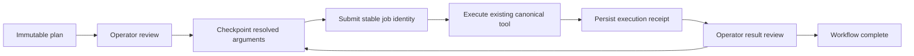

# Shared scientific workflows with LangGraph

LangGraph now coordinates reviewed, multistep scientific plans across eight recipe families. Individual inspection and visualization tools remain directly callable. The numerical engines, alignment runtime, resource admission and external powder supervisor retain their existing responsibilities.

| Recipe | Stages |
| --- | --- |
| `calibration_integration` | Calibrate → review geometry → integrate an explicit image list |
| `ff_reconstruction` | Validate FF parameters → reconstruct → optional report |
| `nf_reconstruction` | Validate NF parameters → reconstruct |
| `pf_reconstruction` | Validate PF parameters → reconstruct |
| `powder_refinement` | Optional planning → submit to existing powder supervisor → optional status/report after verified completion |
| `tomography` | Survey → reconstruct with an explicitly selected center |
| `synthesis` | Inspect → optional PCA → fit declared phases → optional kinetics/advisory recommendation → report |
| `alignment` | Verify the software plan → delegate to existing simulation/replay/read-only shadow runtime |

The catalogue reports whether required tools are registered. That does not establish native-engine availability or numerical qualification. Unsupported techniques retain their current planning/direct-tool behavior; they are not advertised as runnable recipes. New recipes can reuse the runtime, but need their own stage schemas, artifact handoffs and acceptance tests.

## Prepare, review and run

The model can call `list_scientific_workflows`, `prepare_scientific_workflow` and `get_scientific_workflow`. Preparation validates exact stage arguments against the connected MCP schemas and creates an immutable plan, then stops at an initial review gate. It does not execute a scientific tool. Missing geometry, calibrants, paths or phase candidates are not inferred by the recipe compiler.

The WebUI's Analyze panel lists this session's workflows, their ordered stages, plan details and linked job evidence. It displays eight plans per page from the latest 100 session workflows. Operator actions carry the workflow ID, current revision, exact gate ID, typed `approve`/`reject` decision and unique request ID. Stale actions are rejected; a repeated identical request does not submit another job. The CLI exposes the same operator actions:

```text
workflow catalog
workflow list
workflow show WORKFLOW_ID
workflow approve WORKFLOW_ID GATE_ID REVISION "review reason"
workflow reject WORKFLOW_ID GATE_ID REVISION "review reason"
workflow cancel WORKFLOW_ID REVISION
```

CLI actions require the workflow's owning session to be active. Reviewed execution writes its evidence to the workflow/job stores; it does not append results to whichever chat context happened to be loaded previously.

Every completed stage pauses for result review before the next stage. Approval permits continued processing; it does not change an unassessed/provisional scientific verdict into acceptance. Failed, rejected and unresolved receipts cannot advance. Automatic calibration-artifact reuse additionally requires an explicit passed scientific gate. Review immutable arguments and existing artifacts before approving a stage.

Ordinary chat never resumes a gate. The earlier FF-HEDM keyword router has been removed from the normal conversation path: a request to prepare a plan, or an unrelated “ok”, cannot approve its legacy gates. Model calls cannot directly execute a processing stage owned by a pending workflow in the same session. This is a client execution boundary, not an OS sandbox for unrestricted analysis code.

`APEXA_WORKFLOW_MODE=graph` instructs the planner to prefer the shared preparation tools for multistep processing. Explicit workflow tools and UI controls remain available independently of that planner preference. No operator environment setting was changed during implementation. Existing legacy FF-HEDM checkpoint files are preserved, but are not automatically migrated or resumed; inspect their job/artifact state before preparing a new plan.

## Durability and side effects



The default root is `~/.apexa/workflows`, configurable with `APEXA_WORKFLOW_DIR`. LangGraph uses SQLite checkpoints with explicit synchronous durability barriers; unavailable checkpoint storage refuses execution. A separate SQLite workflow index binds session, immutable plan, action revisions and process ownership. Keep both files and the run store together in backup/restore procedures on a qualified local filesystem.

Each stage's JobStore key contains workflow ID, plan hash and step ID. Resolved arguments and upstream receipt digests are persisted before dispatch. The graph reuses a completed job receipt when its own following checkpoint was interrupted. A lost checkpoint never authorizes repeating a job that might already have run. An expired unstarted claim may be resumed only through a typed recovery decision; running, submitted and uncertain work holds for reconciliation. Process lease expiry alone does not steal a workflow from a live owner.

Workflow state, job execution and scientific verdict are separate fields. A completed graph is not proof of valid science. Dataset IDs are explicit declared identities; a string alone does not establish immutable input bytes. Use the acquisition DatasetManifest contract where available and preserve raw/correction files throughout reviewed execution. The graph does not automatically create a universal content manifest for every legacy tool.

Cancellation requests stop further progression and reach the owned async tool operation. An uncertain external outcome remains uncertain after cancellation. Cancelling this graph is not a physical motor STOP or proof that an SSH/cluster job stopped. The alignment recipe only supports simulation/replay/shadow; it delegates its own observation loop and never bypasses the absent hardware broker.

External powder submissions remain `submitted` until their native supervisor's outcome is independently reconciled into the common job receipt. Shadow alignment similarly waits for its external observation/runtime state. The shared graph does not replace those supervisors or fabricate completion by polling an unqualified response shape. Use their existing status tools and verified job reconciliation; do not resubmit to clear a waiting state. Center sweeps also remain direct exploratory tools followed by a new reviewed tomography plan with the selected center.

## API and verification

`GET /api/workflows/catalog`, `GET /api/workflows?session_id=…` and `GET /api/workflows/{id}` expose definitions and authoritative snapshots. `POST /api/workflows` prepares a plan. `POST /api/workflows/{id}/advance` accepts typed decisions and returns 202 only after durable admission when processing continues in a managed background task. Duplicate requests share the same admission barrier; a task waiting for the client lock is not yet accepted. `POST /api/workflows/{id}/cancel` records cancellation. `/api/runs/{run_id}` provides the stage receipt. All routes use the existing single-operator web boundary. Workflow actions share the client's session lock with chat while executing, so this integration does not provide concurrent multi-session scientific execution.

Regression tests cover real registered MCP schemas, all eight recipe contracts, typed gates, stale/replayed requests, failed checkpoint initialization, independent-process ownership, completed/admitted checkpoint crash recovery, cancellation, output binding validation and model gate bypass prevention. HTTP tests verify preparation executes nothing, accepted work runs on the owning event loop and the next stage waits for review. Engine/provider calls are injected offline fixtures; these tests do not qualify real numerical outputs or remote completion protocols.
