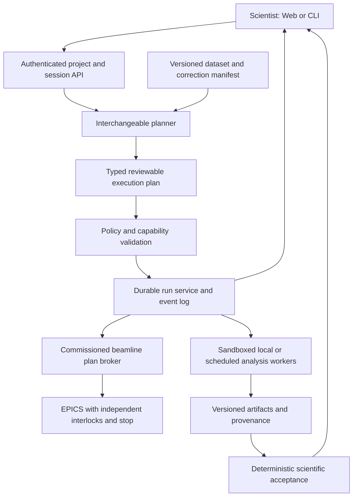

# APEXA deployment and agent-harness audit

**Reviewed 28 October 2026.** Working tree: `~/Git/beamline-assistant-dev`; base commit `60cf9e7d9d134e0d5d555bc045a8fbf3b57f0285`, with substantial pre-existing modifications and new files. See [source-manifest.json](source-manifest.json) for the captured code hashes, [module-inventory.csv](module-inventory.csv) for file-level coverage, and [CVPR_STUDY_PLAN.md](CVPR_STUDY_PLAN.md) for the publication study.

## Assessment

APEXA has a substantive scientific application layer: technique capsules, MIDAS integration, explicit calibration checks, FF-HEDM workflow checkpoints, powder-refinement evidence and trial management, native environment routing, and a usable scientific canvas. These are worth preserving. The next investment should make execution policy, scientific result contracts, data identity, and job recovery consistent across those capabilities.

**Recommendation: continue a controlled, single-user analysis pilot; do not qualify the present tree for a shared service or autonomous hardware operation.** Fix the affected scientific paths before relying on their outputs. Registration of a tool, a successful subprocess, and scientific validation are separate facts.

For the paper, the strongest candidate contribution is an **evidence-backed execution and acceptance layer for scientific inverse problems**, evaluated on detector geometry and FF-HEDM. Whether that contribution is novel and improves outcomes remains to be demonstrated. Counting integrations or adding more agents will not establish it.

For the reported slowness, prioritize blocking scientific subprocess calls, browser workspace serialization, image payloads, and consistent resource admission. LangGraph already implements a real FF-HEDM workflow, but the inspected local launch defaults do not enable it. Keep the current FastAPI/React/LangGraph foundation and repair these execution boundaries; see [STACK_AND_PERFORMANCE.md](STACK_AND_PERFORMANCE.md).

| Deployment mode | Current assessment | Release condition |
|---|---|---|
| Offline inspection and report viewing | Suitable for a controlled pilot | Explicit data roots, qualified readers, reproducible installation |
| Single scientist running local analysis | Conditional pilot | Correct result semantics, cache identity, qualified engine/data combinations |
| Shared beamline web service | Not qualified | Authentication, ownership checks, resource isolation, safe upload/path handling, durable jobs |
| Supervised motor execution | Not qualified | Enforced device policy outside the LLM, fresh interlock/readback checks, real approval, independent stop |
| Autonomous alignment | Not implemented end to end and not qualified | Bounded executor, simulation, commissioned devices, recovery and stop semantics |
| Published harness superiority | Not established | Frozen, leakage-controlled, scientifically validated comparison with appropriate baselines |

## What was checked

The structural inventory covers **132 Python files and 80 TypeScript/TSX files**, including tests, operational scripts, legacy entry points, and benchmark code. All 132 Python files parsed. Detailed review traced the principal UI → agent → MCP → native/remote executor → artifact/report paths and inspected all seven configured MCP server surfaces: **128 decorated tools** (core 13, MIDAS 60, motor 13, alignment 8, GSAS-II 26, tomography 2, synthesis 6).

This is an end-to-end software/deployment audit with offline reproductions, not facility commissioning or a proof of numerical correctness for every external scientific engine. No live motor commands, model calls, remote beamline jobs, or new expensive reconstructions were run. The external Agentic-GSAS-II and MIDAS engine internals were not comprehensively audited here. Dependency advisories, browser accessibility, sustained load, and real multi-host failure recovery remain unverified.

| Check | Observed result |
|---|---|
| Existing Python suite, data/offline mode | **572 passed, 1 skipped**, 18.74 s; one warning |
| Existing frontend Node tests | **38 passed** |
| TypeScript `tsc -b --noEmit` | Passed |
| Vite production build into a temporary directory | Passed; large-chunk warning, including Plotly at about 4.61 MB before gzip |
| ESLint | **5 errors** across four files |
| Focused audit probes | Reproduced motor, policy, result-status, cache, HTTP/upload/origin, benchmark-classifier, and tomography failures |
| Rotation data | Existing 43-row summary/control summary; one complete HDF5 metadata tree and small motor arrays from 30 exposures; final directory lists 43 raw files, 14.99 GB |
| Gold reconstruction | Located MIDAS example data, test harness and real-gold notebook records; no new reconstruction |

Commands and outputs are retained in [validation.txt](validation.txt), [probes.json](probes.json), [tomo-probes.json](tomo-probes.json), and [sandbox-probe.json](sandbox-probe.json). Probe scripts replace execution with stubs; the upload probe writes only into a disposable temporary directory. The sandbox test runs only the driver's `--help` path.

The rotation benchmark changed during the audit. The captured 542-line version added operator metadata and a macOS sandbox. Findings concerning that runner apply to the hash in the source manifest, not automatically to subsequent edits. Application fixes were not made as part of this audit.

The Box directory also changed during inspection: six, then 30, then 43 raw files were visible. The final directory/stat observation is in [rotation-availability-final.json](rotation-availability-final.json); it does not establish complete cloud hydration or byte-level integrity. Earlier counts are retained in the timestamped evidence rather than treated as a missing-data conclusion.

## Findings, ordered by deployment consequence

Priority is conditional: **P0** blocks the affected production use, **P1** is needed for reliable rollout or valid scientific claims, and **P2** improves maintainability/performance. “Reproduced” means an offline probe demonstrated the behavior; “source” means static evidence, with runtime commissioning still needed.

### D01 — P0: motor writes fail open when safety reads fail

**Reproduced.** In [epics_motor_server.py](../../../epics_motor_server.py#L246), failed HLM/LLM/HLS/LLS/RBV reads merely disable their respective checks. A move with every read failed still reached the stubbed `_caput` and returned `move_issued`. A `NaN` target also reached `_caput`, because comparisons do not reject nonfinite values.

`confirm_large_move=True` is a model-supplied argument, not an authenticated operator decision. Motor/PV prefix is caller supplied. `set_motor_limits`, velocity, home, jog and tweak have different checks; jog uses blocking sleep and does not guarantee clearing the jog field in a `finally`. A failed stop/clear is not consistently surfaced. The async motor server contains blocking subprocess and sleep calls, so responsiveness of a stop request during a move must not be assumed.

**Change:** put an execution broker between APEXA and EPICS. Enforce a commissioned device registry, finite values, timestamped readbacks, interlocks, per-action travel/velocity/time limits, ownership leases, and authorization tied to the exact plan. Fail closed on unavailable state. Exclude limit reconfiguration from routine analysis permissions. Keep hardware/IOC interlocks and an independent stop path; an LLM gate is not a protection system.

**Acceptance:** simulated missing/stale readbacks and nonfinite arguments issue zero writes; approval cannot be self-granted; timeout/disconnect produces a reconciled device state; a separately serviced stop remains responsive during every long action.

### D02 — P0: shell access bypasses the advertised policy boundary

**Reproduced at policy level; no commands executed.** [beamline_core_server.py](../../../beamline_core_server.py#L65) permits `caput`, shell interpreters, Python, SSH and network clients. [argo_mcp_client.py](../../../argo_mcp_client.py#L1864) requests human approval only for recognizable shell deletions. Both raw `caput AUDIT:m1 10` and a Python deletion expression are allowed; neither triggers that deletion check. Typed-tool scope and network restrictions also do not constrain arbitrary code equivalently.

The allowlist is an ergonomics filter, not an execution sandbox. A model can bypass the motor API and scientific preflight without exploiting Python itself. Prompt injection in a document or tool result therefore has a broad execution surface.

**Change:** run analysis under a restricted OS identity/container with mounted read-only inputs, a run-specific writable output directory, bounded resources and egress policy. Give that identity no EPICS write access. Hardware writes belong to a separate broker account. Use structured executable adapters for qualified workflows; retain exploratory shell only within the analysis sandbox. Apply policy to HTTP, CLI, watcher and direct MCP callers as well as the agent client.

**Acceptance:** shell/Python/SSH cannot write hardware, escape approved output roots, or reach disallowed destinations; the same policy holds when the MCP server is called directly.

### D03 — P0 for shared deployment: HTTP/WS lack identity and ownership boundaries

**Reproduced/source.** [web_server.py](../../../web_server.py#L73) has broad CORS; `/ws` accepts a foreign Origin; unauthenticated file browsing succeeds. [apexa_session_api.py](../../../apexa_session_api.py#L49) addresses sessions by ID without per-user authorization. One global MCP client, selected model and image/calibration caches serve all connections. A session file lock prevents competing writes; it does not establish an access-control boundary.

The shipped systemd template binds localhost and explicitly recommends proxy authentication. That is useful containment, but proxy login alone does not implement project ownership inside APEXA. Localhost also requires a validated WebSocket Origin policy.

**Change:** authenticate both HTTP and WS, pass a stable principal into every request, authorize projects/datasets/runs/artifacts, and scope all mutable state to a principal and session. Enforce permitted roots and host mappings server-side. Explicitly design the single-console deployment separately from a shared service.

**Acceptance:** user A cannot list, open, modify or attach user B's session or artifacts; foreign-origin WS requests fail; reconnect preserves the authenticated identity and run ownership.

### D04 — P0 for exposed legacy routes: upload path traversal

**Reproduced.** `/api/viewer/load_calibration` joins `upload_dir / file.filename` before validation ([web_server.py](../../../web_server.py#L1433)). A filename `../escaped.txt` wrote outside the upload directory and returned HTTP 200. Similar direct filename joins exist in legacy image loading and analysis uploads. The newer `/api/upload` UUID scheme is better, but it does not protect the other routes.

**Change:** one upload implementation with generated names, confined resolution, size/content validation and bounded streaming. Retire duplicate ingestion routes. File parsing failures must not leave arbitrary writes behind.

**Acceptance:** absolute paths, parent traversal, symlinks and oversized payloads cannot escape or exhaust the upload workspace; all upload entry points share these tests.

### D05 — P0 for scientific trust: failure can be reported as success

**Reproduced.** `/api/analysis/phases` and `/api/analysis/peaks` call names absent from the configured tool inventory and wrap a returned error as `success: true`. `/api/calibrate` labels the stub response “No calibration ran; the engine is unavailable” as “Calibration completed” ([web_server.py](../../../web_server.py#L1798)).

[apexa_ledger.py](../../../apexa_ledger.py#L180) infers success from a short text prefix: `{"error": ...}`, `{"success": false, "return_code": 1}`, `{"status": "failed"}`, and `{"completed": false, "timed_out": true}` all became `ok` in probes. The final-answer gate checks paths/call bookkeeping; after a directory listing it accepted an unsupported numerical calibration claim. This is useful execution accounting, but it does not verify numerical claims.

The MCP client reads only the first text content block and does not normalize the protocol's `isError`/structured content into a common result contract ([argo_mcp_client.py](../../../argo_mcp_client.py#L1922)).

**Change:** define one versioned `ToolOutcome` with independent execution state and scientific verdict, typed quantities with units, evidence/artifact IDs, error codes, engine version, and provenance. Preserve all protocol content. Render execution status and scientific status separately. Attach reported quantitative claims to verified artifact fields. Retire or adapt legacy routes through the same executor.

**Acceptance:** failures cannot become green cards, completed jobs can still be scientifically blocked/provisional, and changing a reported numerical value breaks evidence validation.

### D06 — P0 for affected analyses: idempotency can reuse stale scientific results

**Reproduced.** [_idempotency.py](../../../_idempotency.py#L65) hashes resolved paths and arguments, not input contents or engine identity. Outputs need only exist and be nonempty. Changing the input file in place caused a second invocation to replay the first result without executing. This affects decorated calibration, integration and reconstruction paths. Concurrent same-key submissions have no transactional reservation; top-level directory mtimes are also weak evidence for nested outputs.

**Change:** immutable dataset manifests with content fingerprints, parameter/dark/mask hashes, engine/build identity and recipe version. Reserve a run identity transactionally, track state separately from cached success, and verify the complete output manifest. For large data, hash at ingestion or use an immutable acquisition/object identity plus independently verified metadata; do not rescan terabytes for every tool call.

**Acceptance:** changed input bytes, corrections, parameters or engine build invalidate reuse; two identical concurrent requests share one owned run; damaged nested outputs invalidate the result.

### D07 — P0 for propagation tomography; P1 for the wider tomo adapter

**Reproduced control flow, with a stubbed numerical engine.** [_tomo_runner.py](../../../_tomo_runner.py#L354) calls normalize → minus-log → Paganin phase retrieval. TomoPy's phase filter acts on projection intensities; the propagation workflow should apply it to normalized transmission before minus-log. The current order filters logarithmic attenuation instead. See the [TomoPy implementation](https://github.com/tomopy/tomopy/blob/master/source/tomopy/prep/phase.py).

The same probe found that an unselected center-sweep midpoint is returned as scientific `success`, and a reconstruction containing an infinite voxel can pass `np.isfinite(recon).any() && ptp > 0`. Handedness is required and recorded, but changing it does not change the angle vector; the contract must establish whether it is descriptive or operative and validate consistency with signed omega and volume coordinates. This last observation alone does not prove every signed-omega reconstruction is wrong.

**Change:** validate preprocessing against a trusted propagation reference; make center selection explicitly provisional; require finite valid outputs and physical QC. Use an asymmetric phantom to commission handedness, omega direction and coordinate export. Do not infer scan roles solely from intensity for production acquisition.

### D08 — P1: job durability exists in islands

**Source.** FF-HEDM has LangGraph/SQLite checkpoints and explicit interrupts. Powder has a durable external JobStore, broker, revisioned sessions, bounded trials and a detached workflow supervisor. These are meaningful strengths. They do not cover every long-running tool.

General web requests still use untracked `asyncio.create_task`, a shared client lock, and request-local callbacks ([web_server.py](../../../web_server.py#L1042)). There is no common run queue/ownership/reconciliation contract across MIDAS, remote shell, tomo and synthesis. [apexa_remote_exec.py](../../../apexa_remote_exec.py#L128) timing out SSH does not prove the remote process stopped. Cancelling a thread awaiting `subprocess.run` also does not establish that descendants stopped. Graph checkpoint initialization can fall back to memory with a warning, so cross-restart durability is conditional.

**Change:** reuse existing durable pieces behind one run API: submit/status/events/cancel/reconcile/resume. Give runs stable IDs and leases; record remote job/process identities; reconcile on restart; expose durability level. Use the facility scheduler where available. A checkpointed agent loop and a durable scientific computation are separate resources.

**Acceptance:** kill/restart the UI, API, worker and SSH transport at every stage; completed work is recovered without duplicate submission; cancellation distinguishes requested, acknowledged and stopped.

### D09 — P1: dataset identity and correction state are not universal

**Reproduced in source paths.** The WS context builder appends every globally cached image and says these identify “this image,” even when the request supplies selected-canvas context ([web_server.py](../../../web_server.py#L882)). Statistics are recomputed over full arrays in the async handler. Plans and experiment/ESAF readers improve metadata capture, but they do not give every path the same authoritative dataset, detector, coordinate system and correction identity.

**Change:** a `DatasetManifest` identifying proposal/sample/acquisition/frame map, host, raw data, dark/flat/mask, geometry, units and metadata sources/conflicts. Every request references one selected dataset and a revision of its corrections. Keep display transformations separate from corrections actually applied by numerical engines, and show both.

**Acceptance:** two simultaneous sessions with different selected images cannot contaminate each other's prompt or analysis inputs; a displayed mask is either included in the executed plan or clearly marked display-only.

### D10 — P1: legacy calibration bypasses the newer adapter

**Source.** `/api/auto_calibrate` writes shared `calib_params_temp.txt`, saves a mask but does not add that saved mask to the invoked command, and examines a shared refined-output filename ([web_server.py](../../../web_server.py#L1514)). Workstation-specific fallbacks remain. This path bypasses the better canonical calibration wrapper and its evidence conventions.

**Change:** route every UI action through the canonical adapter, with one isolated run directory, verified fresh outputs, mask provenance and explicit execution host. Remove obsolete routes after migrating callers.

### D11 — P1: alignment is a set of useful primitives, not a completed optimizer

**Source/tool inventory.** [apexa_alignment_server.py](../../../apexa_alignment_server.py#L986) lists task YAMLs, ingests history, estimates priors, fits rotation axes, grabs PVA frames and reduces images. There is no registered `run_alignment` executor, no Xopt invocation, and no complete persisted scan/BO loop behind the task specifications. The eight registered tools are analytical/observational helpers. The YAML's bounded BO behavior is a design specification, not observed implementation.

**Change:** implement one commissioned alignment task through the hardware broker: preflight → bounded proposal → authorization → motion → settle → fresh observation → evaluate → stop/recover. Persist observations and constraints. Historical “good” settings are priors conditioned on instrument configuration, not automatically safe settings for another run.

**Acceptance:** simulated fault scenarios and replay first; then read-only shadow mode; then supervised hardware commissioning with an independently available stop.

### D12 — P1: acquisition completion is heuristic

**Source.** [apexa_acquisition_watcher.py](../../../apexa_acquisition_watcher.py#L124) uses count, nonzero size and a quiet-time threshold. The code correctly calls this a heuristic and restricts automatic execution to supported techniques. Its in-memory `fired` set is not a durable acquisition cursor.

**Change:** consume acquisition completion identifiers/events, dataset closure and frame-count metadata. Persist a cursor and content/version identity. Handle late darks, interrupted writes, reordered frames and replay. Tie every trigger to an idempotent durable job.

### D13 — P1: commissioning and continuous integration are incomplete

**Source/verification.** The only GitHub workflow found is capsule synchronization. The passing Python/frontend suites are not release gates in CI. There is no tested motor safety suite in the inspected tests, and the offline suite does not qualify real TomoPy/GSAS-II/MIDAS installations, CPU/GPU numerical equivalence or beamline recovery.

The inspected APEXA venv has MCP 2.2.0, LangGraph 1.2.12, OpenAI 2.54.0 and Python 3.13.7. Optional engines being absent there is expected for native-environment routing; it is not evidence that they are absent on the beamline. However, `mcp>=1.14.1` permits versions older than the `mcp.server.mcpserver` API the code imports. Locked installs and unlocked installs are different promises.

**Change:** CI for offline tests, lint/typecheck/build, schema contracts and dependency floors; separately versioned native-engine qualification packs. Pin external engine build IDs, model/embedding revisions and GPU precision settings in release manifests. Exercise one clean offline installation and one representative beamline rollout/rollback.

### D14 — P1: observability cannot yet answer shift-operation questions

**Source.** Timing JSONL, interaction logs, a per-turn ledger and feedback capture exist. Timing is opt-in; logging frequently suppresses errors; interaction records retain previews and inferred success. There is no common trace tying principal → dataset → plan → job → subprocess → artifact → scientific verdict, no durable event replay for the browser, and no demonstrated service objectives.

`/api/status` reports MCP connected when an empty client object exists; the audit reproduced `true` with zero sessions. Logs can contain full query/argument/path content despite a comment claiming no PII beyond username.

**Change:** structured spans/events with stable correlation IDs; separate liveness, readiness, engine qualification and data-host reachability. Track queue age, failure reason, retry count, stale data, event-loop lag, CPU/GPU/memory, token use and cost. Redact sensitive payloads before export; make log retention/operator access explicit. Keep production traces available without enabling a debug flag.

### D15 — P1 for publication: the current comparison does not isolate all claimed effects

**Source and reproduced classifier failure.** Rotation benchmark strengths include cloned/copied inputs, fresh subprocesses, a fixed requested model, robust leave-one-out reference fitting, recorded scoring rules and Wilson intervals. Its README explicitly withdraws earlier flawed results; those should remain excluded.

Remaining issues:

- The reference uses APEXA-derived fitted tilts from other exposures, not independent absolute detector metrology.
- APEXA's driver loads all configured MCP servers; the other rotation arms do not receive the same typed adapters. This is a deployed-system comparison, not a tool-matched harness comparison.
- The “enforcement off” arm also disables stage skill/capsule injection and changes metadata inference policy. It is a bundled ablation.
- `claimed_success` merges stdout/stderr and uses positive/negative keyword presence in the tail. “The initial attempt succeeded numerically, but validation failed. Do not use this geometry” is scored as accepted.
- `extract_tz` selects a recent matching file or the first matching transcript number, which need not be the final adopted artifact. Freshness alone is not evidence that a calculation created the number.
- The captured new sandbox denies the repository's `benchmark` subtree, including `_apexa_driver.py`: a real `--help` probe fails before agent startup. Fix this before spending on trials. A denylist still needs qualification for all other local references, notebooks, user configuration and network access.
- Package version, executable hash, actual response model identity, budgets, permission policy and resolved configuration need frozen records. Fresh working directories do not by themselves reset all harness user state.
- Repeats of one specimen/scan series are correlated. Per-trial Wilson intervals do not quantify generalization to new beamlines or specimens.
- The baseline description that Pi has no MCP is outdated: its current official site and installed 1.2.0 documentation describe built-in MCP. Freeze and qualify actual baseline capabilities instead of relying on that assumption.
- The README describes the ±3° cases as accepted failures; the existing summary labels scans 269/276 as gate failures. All 35 accepted rows agree within 0.1° with the leave-one-out trend. This does not establish absolute accuracy, but it does invalidate using those two rows as examples of accepted-wrong outcomes.

See the study plan for a corrected design. No current APEXA-vs-baseline performance ranking is asserted by this audit.

### D16 — P2: frontend quality and scaling

**Verified/source.** Five ESLint errors: control-character regex in `FileListCard.tsx`; component/module export separation in `ToolResultCard.tsx`; synchronous state update in `GSAS2Workbench.tsx`; two memoization findings in `RefinementDecisions.tsx`. Typecheck, tests and production build pass. These are not five demonstrated scientific failures.

The global image cache has no byte budget, uploads read complete bodies, some scientific readers load whole stacks, and browsing silently limits output to 500 entries. Plotly dominates the build size. Add bounded caches, streaming/path-first ingestion, chunked reads, pagination, cancellation and load tests representative of detector data. Do not optimize GPU placement before measuring where time is spent; `apexa_compute.py` already has useful CPU/RAM/workload profiling logic.

### D17 — P2: reduce implementation and interface drift

**Source.** `midas_comprehensive_server.py` is 13,849 lines; `apexa_agents.py` 4,838; `argo_mcp_client.py` 3,170. CLI, React, Gradio, Trame and legacy HTML paths have different lifecycle/approval/data behavior. Gradio initializes MCP on a loop it then closes; that path needs a real lifecycle test before being called the recommended UI. New powder supervision uses POSIX `fcntl`/process groups despite broad Windows-facing documentation.

Extract typed contracts and executor services first, then split scientific adapters by technique without changing their public schemas. Keep React/CLI as the initially qualified product surfaces; mark other frontends experimental until parity tests pass. Generate capability documentation from the registry and a host readiness record. Align installation instructions, tool counts, supported platforms and engine ownership with the actual configuration.

### D18 — P2: knowledge needs provenance and scalable retrieval

**Source.** Capsules, pinned upstream manuals, citation-aware indexing and hybrid dense/BM25 retrieval are valuable. `hybrid_search` reloads the whole filtered corpus per query; index rebuilding deletes/recreates the active collection; embedding code uses `trust_remote_code=True` without an explicit revision at construction. Dataset-specific solutions in lab notebooks are also a benchmark leakage surface.

Cache/index sparse retrieval by corpus revision, stage index updates atomically, pin and verify embedding assets, and carry document/version/source IDs into result evidence. Separate normative procedure, historical observations and user-supplied content. For experiments, freeze and sanitize all retrieved/injected knowledge, including automatic capsule paths.

## Module-by-module disposition

These are assessed capability boundaries, not claims that every backend was executed. File-level structural inventory and test associations are in the CSV.

| Module family | Present and worth retaining | Missing or qualification needed |
|---|---|---|
| `apexa_agents`, client, tool surface | Structured providers, progressive discovery, multi-step loop, compaction, central dispatch | Typed result/policy boundary, durable turn state, common budgets; D02/D05/D08 |
| Providers, endpoints, profiles, token helper, network/model policy | Multi-provider routing, keyring support, token refresh, offline embedding controls | Per-principal configuration, immutable model metadata, constrained egress and release qualification |
| Ledger, timing, interaction logger, feedback | Tool records and diagnostic breadcrumbs | Claim-level evidence and correlated, durable observability; D05/D14 |
| Plan, experiment, logbook, units, shared library | Reviewable plan, ESAF/logbook parsing, unit helpers, image/parameter utilities | Universal typed dataset/correction/coordinate identity; D09 |
| FF-HEDM graph | SQLite-backed progression, explicit interrupts, stale-index handling | Durability must be visible; common jobs and external-effect reconciliation |
| MIDAS FF/PF/NF, grain matching/simulation | Real adapter paths and output checks; fresh-output logic improved | Qualified datasets/builds, schema-stable grain records, physical/reference metrics; no count-only scientific acceptance |
| Calibration runner and native adapter | Four-stage recipe, transform handling, held-out residuals, scope/bound diagnostics | Immutable cache identity, non-overridable production acceptance policy, independent reference qualification |
| Integration, masks, series/peak tracking | Batch reduction, background preparation, comparisons and trajectories | End-to-end correction and uncertainty contract, acquisition IDs, complete output manifests |
| Stress and capability runner | Real wrappers for stress, PDF, defect, ODF, DFXM, XAF, pink-beam and other packages | Per-capability installation/readiness plus reference fixtures; registration is not demonstrated validity |
| GSAS server, powder boundary/workflows/sessions | External engine ownership, durable jobs, trial isolation, revisions and budgets | Qualify external engine versions, cross-platform claims, common run API and auth |
| Powder contract/exports/live/report modules | Separation of execution state from scientific checks, evidence views, restartable exports | Apply this stronger contract across all techniques; validate publication/export consistency |
| MAUD/MILK, GSAS robust, engine comparison | Useful independent numerical adapter options | Reference datasets and uncertainty-aware agreement; engine agreement is not independent physical truth |
| Tomography | Explicit metadata, native interpreter routing, preflight/reconstruction | Preprocessing order and validity semantics; D07 |
| Synthesis runner/server/report | Advisory series fitting, PCA/kinetics/control recommendations, detailed reports | Independent native env/collaborator code qualification, uncertainty and domain validation; no actuated synthesis loop |
| EPICS motor | Existing CA operations and some limits | Enforced broker, fail-closed reads, authorization and stop commissioning; D01/D02 |
| Alignment/history/PVA | Observation and recommendation primitives | One real bounded execution loop; D11 |
| Acquisition watcher | Reviewable plans and restricted auto-execution | Completion events and durable replay; D12 |
| Compute and remote execution | Resource inventory, bounded batches, local/remote resolution | Scheduler/job ownership, hard cancellation and multi-user quotas; D08 |
| Core MCP, legacy file/command/analysis servers | General utilities and extensibility | Sandbox and one security policy; quarantine unqualified legacy endpoints |
| Web/session API and session store | Atomic snapshots, revisions, shared CLI/web memory, turn locks | Authentication/ownership, bounded work queues and per-session cache/context; D03/D09 |
| Viewer/canvas/viz/science gateway | Frame-level reads, typed artifacts, local/remote viewing, static HTML sanitization and iframe CSP | Authorize paths, preserve host/coordinate/correction identity, handle large data and dropped connections |
| React frontend | Rich artifact canvas, results/history, tool events, refinement workbench | Five lint errors, jobs/setup UX, concurrency/accessibility/load qualification |
| CLI/desktop/Gradio/Trame/legacy HTML | Multiple access modes; desktop reuses web UI | One qualified lifecycle and approval contract, documentation consistency |
| Capsule/skill registry and knowledge tools | Domain procedures, citations, upstream synchronization | Provenance versions, trusted/untrusted separation, benchmark sanitization; D18 |
| Benchmarks, AutoGen/DSPy baselines, diagnostic scripts | Existing evaluation and ablation infrastructure | Two-task independent grading, fair tool/knowledge controls, frozen runner; D15 |
| Deployment/build/setup/config | Localhost systemd template, lockfiles, native environment separation | CI release gates, offline artifact manifest, rollback/restore drills, supported-host matrix |

## Comparison with current harness capabilities

“SOTA” is used here as a comparison to mature, documented capabilities, not a numerical league table. Framework choice does not supply instrument safety or scientific validity automatically.

| Reference | Capability demonstrated in its documentation | APEXA implication |
|---|---|---|
| [NVIDIA NeMo migration guide](https://docs.nvidia.com/nemo/agent-toolkit/latest/resources/migration-guide.html#nemo-agent-toolkit-deprecation) | NAT is deprecated as of October 2026, EOL end of 2026. NVIDIA directs observability/governance to **Relay**, harness execution to **Fabric**, and evaluation/optimization/hardening to **Helix** | Do not introduce NAT as a new production dependency. Keep OpenTelemetry as the stable application boundary; evaluate Relay/Fabric/Helix only for a measured need and supported adapters. |
| [Google ADK evaluation](https://adk.dev/evaluate/) and [resume](https://adk.dev/runtime/resume/) | Trajectory/output evaluation, event-based workflow resumption | Add versioned eval sets and durable events. ADK explicitly documents at-least-once tool execution on resume: side-effect deduplication remains the application's responsibility. |
| [LangGraph persistence](https://docs.langchain.com/oss/python/langgraph/persistence) and [interrupts](https://docs.langchain.com/oss/python/langgraph/interrupts) | Checkpointed state, resumable threads, human intervention | Already partially adopted for FF-HEDM. Extend that discipline to plans and jobs instead of reintroducing a second ad hoc orchestration system. |
| [OpenAI agents runtime documentation](https://developers.openai.com/api/docs/guides/agents) | Distinguishes managed harness, application-run SDK and direct API; separately describes state/tool/execution responsibilities | Keep APEXA's domain adapters transport-independent. Provider compatibility is not equivalent to durable runtime support. Official OpenAI documentation was used through the OpenAI Docs skill. |
| [Claude Agent SDK](https://code.claude.com/docs/en/agent-sdk/overview) | Agent loop, context management, sessions, hooks, permissions, MCP | Useful general-purpose baseline and possible interchangeable planner. Keep scientific validation outside the chosen planner. |
| [Pi](https://pi.dev), installed version 1.2.0 | Built-in MCP over stdio/HTTP, configurable tool exposure and Codemode; extensible agent loop | The runner's “no MCP” assumption is outdated. Offer the same qualified scientific adapters in a tool-matched condition and freeze extensions/configuration. |
| [OpenCode MCP documentation](https://github.com/anomalyco/opencode/blob/dev/packages/web/src/content/docs/mcp-servers.mdx), installed version 1.18.23 | Local/remote MCP tools, per-server enablement and OAuth support | Official documentation source was fetched after the hosted-docs request failed. Verify the installed adapter with a fixture; documentation support is not an end-to-end APEXA integration test. |
| Claude Code, installed version 2.1.312 | Relevant deployed baseline, alongside the SDK capabilities above | Preserve actual model/transport, permissions, global configuration and budgets. Version probes and executable hashes are in [harness-versions.json](harness-versions.json). |
| [Bluesky QueueServer API](https://blueskyproject.io/bluesky-queueserver/re_manager_api.html) | Explicit queue/environment state, plan permissions, manager locks and execution controls | Use an approved beamline plan service where the facility supports it; otherwise implement an equivalent narrow broker. QueueServer does not replace IOC/hardware interlocks. |
| [Xopt](https://xopt.xopt.org/) | Existing constrained optimization machinery | Reuse the optimizer after the device/observation contract is commissioned. Installing Xopt is not an alignment executor. |

The advantageous architecture is **interchangeable planner + APEXA's scientific execution layer**. First standardize its interfaces; then benchmark planners fairly. Do not migrate the full application to ADK, NeMo or another harness merely to acquire their names. NVIDIA's earlier NAT profiling documentation remains a useful comparison of instrumentation practices, but its published deprecation materially changes the adoption recommendation. Sources are recorded in [REFERENCES.md](REFERENCES.md).

## Target architecture

A first release can use local SQLite, filesystem artifacts and existing workers on one beamline host. Add a multi-host database/object store only when deployment scale requires it. Separate hardware and analysis identities from the outset.

## Roadmap and measurable release gates

Effort below is an engineering estimate, not a commitment. Hardware commissioning depends on beamline staff and scheduled access.

| Sequence | Work package / owner | Completion evidence |
|---|---|---|
| First 2–3 engineering days | Runtime owner: close raw hardware execution, fail-closed motor checks, disable unqualified legacy routes in deployment profile | D01–D05 probes become negative controls; no shell hardware route; localhost pilot profile explicit |
| First week, performance workstream | Runtime + frontend owners: blocking calibration executor, enforced child thread limits, debounced workspace serialization and artifact references | Measured child overlap with valid outputs; responsive status/stop; browser long-task and interaction traces improve on the same long session |
| First week | Runtime + science owners: common outcome contract and corrected cache identity; qualify tomo path | Failure/status matrix, modified-input/restart tests, trusted tomo reference and nonfinite rejection |
| First week in parallel with study preparation | Benchmark owner: freeze runner, metadata, sanitized docs, artifact grading and no-LLM startup preflight | Every harness runs the same fixture and emits an auditable artifact; no reference access; exact versions saved |
| Following 1–2 weeks | Platform owner: common run API, event replay, ownership, cancel/reconcile, dataset manifest | UI/API/worker/SSH crash drill; no duplicate scientific jobs or cross-session data |
| Following 2–4 weeks | Beamline scientist + controls engineer: one alignment task in simulation, shadow mode, then supervised operation | Signed-off device envelope, stop/timeout/failure behavior and independent physical checks |
| Before shared release | Operations + platform owners: auth, CI, quotas, monitoring, backup/restore and rollback | Two-user isolation/load tests; clean host deployment; restore and rollback executed |

For operations, define SLOs from an actual beamline pilot: request acceptance latency, job-start delay, preview latency, recovery time, and maximum stale-readback age. Do not invent universal millisecond or accuracy targets without instrument requirements. For scientific results, acceptance tolerances belong to a versioned technique/instrument policy and an independently justified reference.

The highest-value next deliverable is a narrow qualified slice: **inspect one dataset → review a typed plan → submit once → survive restart → display verified artifacts and scientific verdict**. Use it for calibration and FF-HEDM before broadening autonomous control.

## Follow-up: LangGraph, performance and compute allocation

The user's performance and stack questions are addressed in [STACK_AND_PERFORMANCE.md](STACK_AND_PERFORMANCE.md), including the actual local LangGraph configuration and measured probes.

**D19 — P1: advertised calibration concurrency does not reach the numerical worker.** `midas_auto_calibrate` is an async function with no `await` and directly calls blocking subprocesses. `midas_calibrate_series` schedules these coroutines with a semaphore, so the canonical calls serialize. `plan.threads_per_worker` is not passed to the child environment. The actual async shell tool showed the same behavior in a safe four-worker probe: one active stub operation, 0.621 s for four 0.150 s operations. Repair with supervised asynchronous subprocess jobs and explicit child environments, then verify overlap and scientific equivalence.

**D20 — P1: resource planning is advisory and inconsistent across techniques.** A probe with 0.1 GB available RAM and a 7 GB worker profile still admits one worker. Integration uses a separate core-count heuristic, while FF/NF/powder use other scheduling paths. Introduce zero-admission/queue behavior, global CPU/RAM/GPU leases, data-local placement, measured stage profiles and a common execution plan.

**D21 — P1 for interactive UX: workspace persistence performs synchronous bulk work before its debounce.** `scheduleWorkspace` serializes/caches session data on canvas and settings changes; only the network write is delayed. Persist small artifact references, defer serialization, and virtualize long lists. Current Plotly loading is already lazy; optimize the remaining first-plot/data/render costs using browser traces.

A read-only sample of the running localhost service was responsive at idle (status calls 52 ms and 1.5 ms). This does not contradict slow analysis sessions; no production model/engine latency trace or browser CPU profile was collected.
