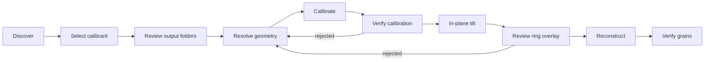

# APEXA stack, LangGraph and performance recommendations

Reviewed 28 October 2026. This extends the [deployment audit](AUDIT.md), with particular attention to the reported slow WebUI/agent behavior and compute use. Recommendations below distinguish source-proven problems, local measurements, and work requiring production traces.

## What LangGraph currently does

**LangGraph is installed and implemented, but not enabled by the local configuration inspected.** The APEXA environment has LangGraph 1.2.12. Neither the inspected `.env` nor the audit shell sets `APEXA_WORKFLOW_MODE`. The orchestrator reads that flag at construction ([apexa_agents.py](../../../apexa_agents.py#L3961)); only the literal value `graph` enters the FF-HEDM graph route ([process](../../../apexa_agents.py#L4710)). A running server started with a different environment could differ; `/api/status` does not expose this state today.

When enabled, graph mode runs a real ten-node FF-HEDM procedure:



It provides persistent state, ordered stages, explicit human gates, and resume via `Command(resume=...)`. The default durable implementation uses `AsyncSqliteSaver`, `~/.apexa/ffhedm_graph.sqlite`, and a state sidecar. Tests exercise pause/resume, restart, session isolation and interrupted steps. It is more than an unused dependency.

Its boundary is narrow: it triggers on an already-active FF workflow or an FF/far-field execution request. Other requests fall through to APEXA's custom agent loop. It does not schedule all engines, allocate GPUs, authenticate users, or manage arbitrary remote subprocesses. “Abandon workflow” explicitly does not stop external jobs. If the SQLite checkpointer cannot initialize, it can fall back to memory with a warning.

**Recommendation:** retain LangGraph and make it the explicit scientific workflow layer, with technique-specific state machines and reusable typed nodes. Keep an exploratory chat mode. Make the active mode, workflow ID, checkpoint persistence and current gate visible in the UI. Replace keyword-only workflow selection with an explicit validated workflow request. Do not assume simply turning the flag on fixes deployment defects.

For an isolated trial after addressing the audit's execution issues, the existing configuration switch is `APEXA_WORKFLOW_MODE=graph`; `APEXA_FFHEDM_DB` can select the checkpoint database. This audit did not change the user's settings or enable graph mode.

## What was measured

[performance-probes.json](performance-probes.json), [live-http-readonly.json](live-http-readonly.json), and [local-process-observation.json](local-process-observation.json) retain observations. No model request, scientific calibration, hardware operation or load test was launched.

| Observation | Result | Meaning and limit |
|---|---|---|
| Four workers calling the actual async shell tool, with its subprocess replaced by a 150 ms stub | Peak active operations **1**; total **0.621 s**, against 0.600 s serial service time | Demonstrates that an async declaration does not make a blocking body concurrent. No shell ran. Calibration has the same no-await pattern. |
| Resource plan with 0.1 GB free RAM and a 7 GB per-worker profile | Admits **1 worker** | Memory admission is floored at one rather than queued/refused. |
| 2880×2880 synthetic float32 frame → default 1024-pixel preview | Median **0.181 s**, preview **4.16 million base64 characters** | In-memory local measurement; omits file read, transfer, browser decode and render. Compression depends strongly on image content. |
| Same frame with radial profile | Median **0.293 s** | Full-resolution profile computation adds work; repeat it only when the data/corrections/center change. |
| Eight full-image statistics passes, matching the global-chat-context pattern | **0.117 s** | This work runs synchronously in the WS context path; cost grows with loaded images. |
| Running local web server: status/root/status | **52 ms / 26 ms / 1.5 ms** | Idle local HTTP is responsive. These samples do not measure model latency or behavior during analysis. |
| Local hardware snapshot | **10 CPU cores, 32 GB RAM, 6.4 GB available** | Transient host condition, not a capacity guarantee. Do not plan against total RAM. |
| Production frontend bundle | Main about **605 KB**, Plotly about **4.61 MB** before gzip | Plotly is already lazy-loaded; do not claim it is always in first paint. First plot still incurs its load/decode cost. |

The running web service reported six connected servers; the working tree config enables seven, including synthesis. This is evidence of a runtime/configuration difference, not proof that synthesis failed. Add build/config/version information to health so the UI can distinguish an old process from a current checkout.

No browser CPU profile or real provider timing trace was captured, so an exact percentage attribution of the user's observed delay would be unsupported.

## Fix these performance paths first

### 1. Make scientific execution genuinely asynchronous and bounded

The following async functions contain **zero `await` expressions** in the captured source:

- `midas_auto_calibrate`, including blocking `subprocess.run` at line 6929.
- `midas_integrate_series`; its internal thread pool can parallelize files, but the enclosing MCP handler waits synchronously.
- `run_command` and `run_remote_command`.
- `move_motor_absolute` and `jog_motor`, including blocking device polling/sleep.

`midas_calibrate_series` calls `apexa_compute.run_batch_async`, which uses a semaphore plus `gather`, but each calibration coroutine runs synchronously until completion. The semaphore expresses a concurrency limit without creating a concurrent executor. Separately, `plan.threads_per_worker` is not forwarded to `_one` or used by the canonical calibration subprocess, whose environment is `dict(os.environ)`. `worker_env()` exists but has no production caller in the inspected root Python modules.

**Implementation:** prefer a supervised subprocess worker with asynchronous submission/status/events and a separate process group per run. For a small first repair, put a synchronous engine adapter behind `asyncio.to_thread`, with an explicit semaphore and immutable per-run arguments; that can restore event-loop responsiveness but does not by itself implement cancellation or kill descendants. Production cancellation needs a process/job identity and acknowledgement. Pass OMP/MKL/OpenBLAS/thread/device limits in the child environment, never by mutating shared `os.environ` between concurrent workers.

**Validation:** instrument actual child overlap and peak RSS; compare numerical results under concurrency; verify that health/status/stop remain responsive; test worker crash and cancellation. A timing probe with a stub is an architecture test, not a claimed production speedup.

### 2. Remove browser serialization from every interaction

`chatStore.scheduleWorkspace` captures the workspace, stringifies it, updates session state and writes the entire session collection to localStorage before the 600 ms network debounce ([chatStore.ts](../../../frontend/src/stores/chatStore.ts#L138)). Canvas selection and image-setting changes subscribe to this path. The network write is debounced; much of the expensive browser work is not.

`durableWorkspace` strips sequence/diffraction previews, which is good, but retains other artifact payloads, including potentially large Plotly arrays and image artifacts. A long analysis session can therefore repeatedly serialize substantial data while the user changes display settings. `MessageList` renders all messages and scrolls smoothly on every message/loading change.

**Implementation:** store artifact references and small viewer state in workspace records. Debounce snapshot construction and persistence, not only HTTP submission. Save browser cache asynchronously through IndexedDB if needed; keep server storage authoritative. Use version/dirty counters instead of whole-object stringify comparisons. Virtualize long message/result lists, preserve stable plot props, and avoid smooth-scroll work when the reader is inspecting older messages.

**Validation:** record browser long tasks and interaction latency with a realistic long session, 50 result artifacts and large plots. Test persistence/recovery while making these changes; faster interaction must not silently lose state.

### 3. Keep image interaction separate from scientific data transfer

The current sequence viewer already bounds preview dimensions, uses synchronous FastAPI routes that run in the threadpool, and supports request cancellation. Preserve that. The remaining costs include complete array reads/corrections, exact percentiles, optional profiles, RGBA PNG generation and base64 JSON transport on updates.

**Implementation:** cache raw/corrected frames by dataset fingerprint + frame + correction revision. Cache statistics/profile by their own dependencies. Use binary preview responses and avoid repeating the same encoded image in session records. Fetch a smaller preview while scrubbing and refine when idle. Consider client-side contrast/colormap using a bounded numeric texture, retaining exact full-resolution values and ROI calculations on the server. Use multi-resolution tiles for very large detectors/volumes. Never use display downsampling as the quantitative analysis input.

Use data-host-side reading and reduction: return a preview/ROI/artifact reference to the laptop rather than copying whole HDF5 files through the chat application. Box/OneDrive hydration and beamline filesystem latency need their own spans, separate from engine time.

### 4. Reduce model round trips without weakening verification

The structured tool-call branch executes calls sequentially, even when a model requests independent reads together. It also retains full tool-result text in conversation state. Compaction is primarily triggered between turns, so a long multi-tool turn can accumulate large context. An iteration cap limits calls but does not bound total prompt bytes or wall-clock cost.

**Implementation:** return bounded structured summaries plus artifact IDs; fetch details on demand. Add token-aware in-turn context management while preserving authoritative facts and call/result pairing. Parallelize only declared read-only tools with disjoint/resource-safe access. Keep writes, shared-output calculations and hardware plans ordered. For established workflows, let LangGraph run deterministic stages without an LLM deciding each next executable. Keep model use for intent, diagnosis and ambiguous scientific choices.

Use a qualified smaller model for low-risk routing/metadata classification only if an evaluation demonstrates adequate accuracy. Expensive scientific decisions and acceptance remain separately validated. Stream narration and job progress to improve perceived responsiveness; streaming does not reduce the underlying computation time.

### 5. Unify resource decisions

Today several policies coexist:

- `apexa_compute.plan`: host inventory, profile, CPU/RAM caps, device selection.
- Calibration series: consumes its worker count/device, but not its thread environment.
- Integration: legacy worker count `min(16, cpu_count // n_cpus)` and separate placement heuristic.
- `_pick_compute_target`: when no task profile is passed, a local accelerator can win just because it exists; integration uses that path.
- FF/NF: internally parallel engine/scheduler behavior, not consistently mediated by the same resource service.
- Powder: a separate broker with its own workers and thread limits.

The calibration profile already records that an A6000 provided little benefit on one measured workload. Those are existing developer measurements in the source, not results rerun by this audit. They justify re-measuring rather than assuming a GPU helps every scientific algorithm.

## A compute policy appropriate for a beamline

The LLM should specify intent and constraints: technique, dataset, deadline/priority, approved numerical precision, and allowed hosts. A deterministic scheduler should select resources using measured profiles and current capacity. Show its explanation before and during execution.

A job manifest should include:

```text
run_id, dataset_fingerprint, recipe_version, engine_build
input_host, input_bytes, output_host, required_capabilities
precision, reproducibility_policy, cpu_affinity, threads_per_worker
workers, peak_ram_per_worker, gpu_ids, peak_vram_per_worker
queue_priority, acquisition_reserve, timeout, cancel_policy
estimated_io_s, estimated_compute_s, estimated_queue_s
profile_key, profile_confidence, placement_reason
```

**Placement objective:** minimize expected queue + data access/transfer + setup + compute + result-transfer time, subject to permissions, memory/VRAM limits and numerical qualification. A simple measured cost model is sufficient initially; it does not require another agent or an RL scheduler.

For independent CPU jobs, bound concurrency by remaining CPU/thread budget, RAM after reserve, I/O capacity and task count. Crucially, allow **zero admitted workers** when the job does not fit: queue it, choose another qualified host or refuse with an explanation. Do not force at least one. Internally parallel FF/NF jobs need RAM checks too.

For GPUs, use measured speedup for the exact engine/stage/precision and representative shape. Track peak VRAM separately from CPU RSS. Assign specific GPU IDs and acquire leases; do not send every worker to the largest currently free GPU. Reserve acquisition/display capacity. Use NVML for low-cost NVIDIA telemetry where available; avoid importing a heavy tensor runtime merely to populate a status badge. Scheduler/cgroup allocations take precedence over physical machine core count or load average.

Profiles should be keyed by engine/version, hardware, dtype, detector dimensions, number of frames, algorithm and representative data regime. Record actual runtime, RSS, VRAM, I/O and numerical checks after each run, then update robust estimates. Current profiles are keyed largely by task; copied host-specific defaults can become stale. Avoid unrequested expensive autotuning on user data during a beamtime shift.

| Workload | Initial policy to qualify |
|---|---|
| Frame preview / metadata / ROI | Run near data, bounded small worker pool; cache; keep interactive priority |
| Many independent calibrations | CPU fan-out with enforced thread/RAM budgets; GPU only after demonstrated benefit |
| Batch integration / peak fitting | Benchmark CPU/GPU at realistic batch sizes including data movement; avoid nested oversubscription |
| FF/NF reconstruction | One scheduled workflow with stage-specific resources; exploit the engine's internal parallelism |
| Powder trials / series | Existing broker with global capacity leases and revision-safe trial outputs |
| Long tomography / large volumes | Chunk/stream or scheduler job, estimated RAM admission, qualified backend |
| Motor/alignment operations | Dedicated responsive control service; analysis saturation cannot block stop/readback |

Measure useful throughput and valid-result yield, not maximum CPU/GPU utilization. A fully occupied machine that delays acquisition or changes numerical results is a worse beamline system.

## Recommended tool stack

Keep the stack small and compatible with existing code. “Modern” should mean a clear responsibility, maintained interface and measurable benefit.

**Current NVIDIA lifecycle check:** the [official migration guide](https://docs.nvidia.com/nemo/agent-toolkit/latest/resources/migration-guide.html#nemo-agent-toolkit-deprecation) says NeMo Agent Toolkit was deprecated in October 2026 and reaches EOL at the end of 2026. Do not add NAT as a new production dependency. NVIDIA points to **Relay** for observability/middleware/governance, **Fabric** for harness/custom-agent execution, and **Helix** for evaluation/optimization/hardening. These are candidates for a bounded compatibility pilot; this audit did not install or benchmark them. Preserve OpenTelemetry spans and APEXA's contracts independently of the selected vendor tooling.

| Responsibility | Recommendation | Adoption decision |
|---|---|---|
| Scientific workflow state | **LangGraph** | Keep and expand explicit workflows; show graph/durability state. Do not use it as a GPU allocator. |
| Contracts and validation | **Pydantic v2** | Declare directly; model dataset/plan/outcome/artifact/job schemas, finite quantities, units and revisions. |
| APIs and UI | **FastAPI + React/TypeScript + Zustand** | Keep; fix execution/persistence/rendering paths before considering a rewrite. |
| Run/session persistence | **SQLite on local disk initially; PostgreSQL for a shared service** | Unify ownership, revisions and leases. Select compatible LangGraph checkpointer; do not place active SQLite state on an unqualified network filesystem. |
| Scientific execution | **Existing supervised workers + facility scheduler adapters** | Reuse the powder supervision pattern; add a Slurm adapter if the target facility uses Slurm. Avoid introducing multiple competing job frameworks. |
| Hardware control | **Facility-approved EPICS plan broker; Bluesky/Ophyd + QueueServer where supported** | Narrow registered plans, explicit state and commissioned device envelopes. Adapt to existing controls rather than forcing a beamline migration. |
| Tracing and profiling | **OpenTelemetry + one self-hosted trace viewer; evaluate NeMo Relay if helpful** | Instrument the current harness. Phoenix or Langfuse can be evaluated as the viewer; choose one after a small trace pilot. NAT is deprecated. |
| NVIDIA resource telemetry | **NVML; DCGM for managed NVIDIA fleets if already supported** | Separate utilization/VRAM measurement from scientific placement policy. No promise of GPU benefit without workload measurements. |
| Scientific data access | **HDF5/Zarr near the data; optional Tiled catalog** | Add Tiled if multiple users need authorized lazy dataset access. Do not duplicate raw data into the chat/session database. |
| Large-array execution | **Dask only for demonstrated chunked-array workloads** | Useful for I/O/array work at scale; unnecessary for dispatching a few independent subprocesses. |
| Authentication | **Existing facility OIDC provider + authenticated API/WS** | Reuse facility identity; project authorization still belongs in APEXA. |
| Environments/deployment | **uv lockfiles + staged wheelhouse; separate pinned engine envs; containers/Apptainer where facility supports them** | Record engine/build/CUDA/precision provenance and qualify offline installation. |
| Testing | **pytest + property/fault tests; Playwright for browser journeys; Ruff and current TS checks in CI** | Prioritize scientific invariants, crash/restart, motor policy and long-session interaction tests. |
| Experiment evaluation | **Frozen local numerical evaluator + trace-based evals** | Independent artifact scoring is mandatory. Evaluate ADK's evaluation tooling or NeMo Helix against a small fixture if it reduces maintenance; keep scientific scoring local and versioned. |
| Interchangeable harness adapters | **Existing adapters initially; evaluate NeMo Fabric** | Its documented model/tool/skill/MCP configuration and normalized outcomes may fit the paper rig. Check its adapter compatibility matrix and preserve budgets, model identity and scientific artifacts across adapters before adopting. |

Defer Temporal/Ray/Kubernetes until multi-host durability, distributed execution or fleet operations create a measured need. They can be appropriate later, but introducing all of them now would expand operations work before fixing known bottlenecks. Move AutoGen/DSPy baseline packages and unused alternate UI dependencies into optional groups if they are not part of the qualified deployment.

The captured [Fabric adapter matrix](https://github.com/NVIDIA/NeMo-Fabric/blob/main/adapters/README.md#configuration-compatibility) lists Claude, OpenCode and Pi adapters, but it marks Pi MCP as **not exposed through Fabric**, even though current Pi itself supports MCP. It also does not expose OpenCode's normalized tool policy. This is an adapter limitation, not a lack of native harness capability. Fabric may reduce lifecycle plumbing, but it cannot be assumed to provide the equal tool/permission surface needed by the paper. A small no-model contract fixture should decide whether to adopt it, extend an adapter, or keep the direct drivers.

## A practical performance work sequence

1. **Capture one representative slow run.** Record timestamps from click → request acceptance → model first token → tool dispatch → queue → native execution → artifact → canvas render. Include browser long tasks and data-host I/O. Preserve model/engine configuration.
2. **Repair blocking execution and apply worker limits.** Verify concurrency with real child-process telemetry and scientific output equivalence. Separate jobs from request lifetime.
3. **Fix workspace persistence and image transfer.** Keep hot interaction paths small; use artifact references, bounded previews and cached computations.
4. **Unify scheduling.** Resource leases, zero-worker admission, task/version-specific profiles, host/data locality and per-GPU assignment.
5. **Reduce model overhead.** Deterministic graph stages, bounded tool summaries, declared-safe read parallelism and qualified model routing.
6. **Enforce regression budgets.** Agree pilot-specific targets for interactive latency, preview latency, job acceptance and throughput. Report p50/p95 and valid-result rates on the same hardware/data; do not claim universal speedups from the local probes.

The first two engineering changes I would implement are the blocking calibration executor and synchronous browser workspace persistence. They address directly observable architectural causes of the reported slowness while preserving the scientific tools and UI investment.
