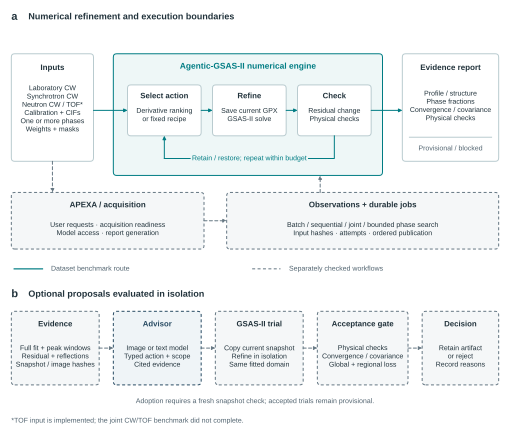

# Powder refinement in APEXA

APEXA provides a shared interface for powder diffraction, detector reduction,
HEDM, tomography and instrument tools. Powder refinement runs in the independently
installed [Agentic-GSAS-II engine](https://github.com/pawantr/Agentic-GSAS-II).
APEXA owns conversation, model access, job presentation and reporting; the engine
owns observations, numerical refinements, evidence and trial decisions.

The [GSAS-II canvas workbench](gsas2-workbench.md) documents the 21 October
integration: all official tutorial pages, installed native operations, queued
atomic-refinement options, policy sweeps and versioned diagnosis/adoption sessions.



Architecture from the manuscript revision `741add8`, synchronized 15 October 2026.
The numerical benchmark and the separately checked queue, APEXA and advisor
interfaces have different evidence scopes. [Figure provenance](assets/powder-architecture-source.json).

## Configure the engine

| Setting | Default / purpose |
|---|---|
| `APEXA_GSASII_PYTHON` | `~/miniconda3/envs/GSASII/bin/python`, with GSAS-II available |
| `APEXA_AGENTIC_GSAS2` | `~/Git/Agentic-GSAS-II`, independent engine checkout |
| `APEXA_GSAS2_JOBS` | `~/.apexa/gsas2_jobs`, durable job state and artifacts |
| `APEXA_POWDER_VISION_MODEL` | Optional image-capable model for diagnostic proposals |
| `ARGO_USER` / `ANL_USERNAME` | Identity for the configured structured provider |

Model endpoint configuration follows APEXA's existing provider settings.
Numerical batches do not require an image model. GSAS-II executes in a subprocess
with numerical threads limited per worker; do not install it into the web server
interpreter merely to use the bridge.

## Choose the workflow

| Workflow | Submission | Input relationship |
|---|---|---|
| Independent batch | `powder_refine_submit(mode="independent")` | Each observation may have different sample, instrument and CIFs |
| Multiphase refinement | Supply several `cif_paths` in an observation | Known candidate phases fitted to the same pattern |
| Ordered series | `powder_refine_submit(mode="sequential")` | New data for every frame; compatible state can transfer from an eligible predecessor |
| Joint instruments | `powder_refine_submit(mode="joint")` | Matching sample/phase identity; differing conditions require explicit shared-structure justification |
| Candidate mixtures | `powder_refine_submit(mode="search")` | Bounded candidate pool; retrieval and phase identity remain separate questions |
| Arriving frames | `powder_live_ingest` | Ready observations with stable series and frame identity |
| Single synchronous fit | `refine_pattern` | Supplied CIFs and one pattern; use durable submission for long work |
| MIDAS caked output | `midas:run_gsas_refinement` | Existing MIDAS integration/refinement workflow |

Batch jobs can mix laboratory and synchrotron observations. Joint fitting requires
compatibility; instrument differences alone do not justify sharing sample state.
The CW/TOF interface exists, but the frozen joint TOF benchmark timed out.

### Observation metadata

Each observation needs `data_path`, `instrument_path` and nonempty `cif_paths`,
all accessible to the engine host. Preserve:

- Axis and units: `two_theta`/`degree`, `q`/`1/angstrom`, `d`/`angstrom`, or
  `tof`/`microsecond`. Q/d conversion requires `wavelength_A`.
- Reader: `format="xye"` for x, intensity, standard-deviation columns;
  native GSAS files use the corresponding reader hint, such as `"GSAS"`.
  TOF needs a native reader and its calibrated instrument file.
- `source`, `radiation`, `geometry`, `sample_id`, `frame_id`, `conditions`,
  `calibration_id` and `calibration_status` when known.
- `intensity_semantics`: `counts`, `integrated`, `normalized` or `remapped`.
  Do not substitute variance for standard deviation or manufacture uncertainty.

The engine hashes inputs and instrument/CIF files, and checks their contents at
execution. Use a new observation identity for revised data.

For a physical scan coordinate, use
`conditions.scan_coordinate={"value": 12.5, "units": "s"}` (or the appropriate
unit). `refine_series_submit(axis_values=..., axis_units=...)` populates this
metadata. It is separate from diffraction `axis`/`units`. The canvas plots against
the scan coordinate when every job supplies one with matching units; otherwise
it uses job index. Separate observations remain separate points.

### Submit, poll, inspect

1. Retrieve candidate CIFs with `propose_structures` if needed. M20 ranks candidates;
   it is not a calibrated probability of phase identity.
2. Submit observations once with `powder_refine_submit`. Keep the returned batch
   ID and engine job IDs.
3. Poll `refinement_status`. Its `outcome_summary` separates execution failures,
   cancellations, pending jobs, completed blocked/provisional results and missing
   residuals. Raw engine evidence remains in `jobs`.
4. Inspect each job's fit, configured checks, reference/effective cells and
   phase fractions. In a batch canvas, select a job to see its metrics and trace.
5. Generate an HTML report with `powder_report`. Use `powder_job_control` for
   cancel/retry/resume. Durable jobs survive the conversational session.

For arriving data, supply an acquisition completion marker where possible.
File stability is a readiness heuristic. Poll the individual IDs returned in
`jobs.fast` and `jobs.full`; periodic full diagnosis is separate from fast tracking.
Throughput, latency and recovery under sustained acquisition still need measurement
on the target beamline.

## Interpret the evidence

| Field / status | Meaning in the current engine |
|---|---|
| Execution completed | The process produced a result; this is not scientific validation |
| `scientific_status="blocked"` | At least one configured check failed; not an expert ground-truth incorrectness label |
| `scientific_status="provisional"` | No configured check failed; some checks may remain unavailable |
| `qualified` | No current engine path emits this status; a zero count is not an accuracy measurement |
| `evidence_coverage` | Physical state, geometry, covariance, convergence, constraints and calibration, each with its own status |
| `idle`, `max_steps`, `wall_clock` | Scheduler/budget stops; inspect the separate solver convergence evidence |

An instrument file marked `PROVISIONAL` fails the calibration check and blocks
the result. Otherwise external calibration evidence can remain unavailable.
Covariance and final solver shift/sigma evidence must be considered independently
of residual reduction. Missing evidence never becomes a passed check in APEXA.

Phase fractions are normalized over modeled crystalline material. Unmodeled or
amorphous phases, absorption, texture and calibration affect interpretation.
Joint fractions retain their histogram scope. Fixed/missing standard uncertainties
are not measured zero uncertainty. HStrain can change effective cells while the
reference cells remain fixed. Remapped RRUFF intensities do not support ordinary
QPA or atomic displacement accuracy claims.

## Image-guided proposals and isolated trials

`powder_evidence` writes an immutable GPX snapshot, global and peak-window PNGs,
hashes and an `evidence.json` bundle. `powder_advise` sends real images through the
configured structured provider and returns at most three typed proposals. The
bridge checks that observation/snapshot identity and cited panels match the images
actually transmitted. It records panel hashes, prompt/evidence hashes and available
model identifiers; an alias alone does not establish a reproducible model version.

`powder_trial` evaluates a proposal in a separate snapshot copy. It retains the
baseline active parameter set while releasing the proposed terms. The legacy
`uiso` action releases the existing atomic displacement representation, which may
be anisotropic. Cell proposals must account for coupling to HStrain.

Current acceptance requires all of the following:

- Configured structural checks and explicitly passed covariance and convergence.
- Global Rwp reduction greater than **0.001 percentage points**.
- No individual histogram worsens by more than **0.05 percentage points**.
- Strict reduction in weighted residual loss over the **union of cited windows**.

Individual windows can worsen even if their combined loss decreases. Inspect them.
Standalone trials leave separate candidates. Versioned sessions can adopt them
through `powder_adopt` or `powder_improve`, which compare the current revision and
snapshot with the proposal's baseline and check the recorded artifact hashes.
The bounded loop regenerates evidence after each adoption. Scientific limitations
from the source result remain visible; numerical acceptance does not qualify a result.

## Audited evidence snapshot

The manuscript's frozen numerical run is `release_20261014T224410Z`, scientific
fingerprint `651d117cbd854308`. [Machine-readable snapshot and source hash](data/powder-benchmark-20261015.json).

| Scope | Audited result |
|---|---|
| Execution | 13 suites attempted; 11 runner completions; two failed suites produced no records |
| Records | 1,676: 1,514 completed blocked, 157 provisional, five execution errors |
| Numeric residuals | 1,669 finite values; two completed records lack a numeric fit |
| RRUFF comparison | 234 paired IDs, 232 completed pairs, 231 unique prepared input hashes, 149 mineral names |
| Supplied-phase mixtures | 20 DARA mixtures, 50 dependent estimates; pooled median absolute error 24.97 percentage points; all 20 blocked |
| Detector observations | 1,161 sectors from four acquisitions, not 1,161 independent experiments |
| Temperature series | All 17 frames blocked; no successor warm-start in this scientific series |

These numbers describe the numerical orchestrator, not a complete LLM/VLM
acquisition loop. Small transfer and shadow-trial examples establish interface
mechanics. They do not establish better QPA, reliable sequential recovery,
benefit from vision, or sustained live throughput. APEXA presentation updates do
not change the frozen benchmark numbers.

## Scientific basis and sources

Brian H. Toby originated the refinement concept and is a manuscript coauthor.
Derivative ranking follows [Toby (2024)](https://doi.org/10.1107/S1600576723011032).
Crystallographic interpretation draws on [Powder Crystallography, edition 0.9.3](https://github.com/briantoby/PowderCrystallography/releases/tag/v0.9.3),
released 13 October 2026. Calibration, parameter correlations and conditional
uncertainties constrain which conclusions a fitted profile can support.

- [Independent engine repository](https://github.com/pawantr/Agentic-GSAS-II)
- [Manuscript repository](https://github.com/pawantr/Agentic-GSAS-II-manuscript),
  local revision `741add8`; its supplement retains the complete surveyed-source inventory.
- [Diffraction software survey and actual APEXA integrations](diffraction-software-survey.md)

## Scientific recipe (2026-10-21)

The default `toby-0.9.3/1` recipe is enforced by the engine. The tool
`gsas2_capabilities` includes a complete 30-chapter coverage map. `plan_refinement`
returns `submission_metadata` and `submission_recipe`; pass those to
`powder_refine_submit` (or persist `refinement.recipe` in an APEXA plan).

Key controls include per-histogram probe/geometry verification, real conditions,
explicit exceptional-parameter justifications, exact instrument/displacement
releases, selected-atom groups, calibrated profile holds, reference-cell/HStrain
separation, convergence/covariance checks, rollback and compatible joint Le Bail
comparisons. The canvas exposes recipe exclusions and actual new variables.

Example policy (numeric thresholds are engineering defaults):

```yaml
refinement:
  recipe:
    version: toby-0.9.3/1
    reference_histogram: 0
    min_improvement_pct: 0.001
    max_histogram_worsening_pct: 0.05
    justifications: {}
    shared_structure_justification: ""
```

Use `observation.experiment.goniometer_radius_mm`, `conditions.temperature_K`,
`geometry`, `radiation`, `calibration_id` and `calibration_status` when supported
by measurement records. A validated calibration declaration holds the profile;
independent validation of the standard is not implied. Preserve actual differing
conditions; justify a shared structural model or choose independent/sequential fits.

Occupancy/contrast constraints, restraint selection and weight sensitivity,
anisotropic broadening, rigid bodies, Fourier interpretation, symmetry and
indexing remain explicit expert workflows. General scientific reliability still
requires representative expert-reviewed cases. Existing historical results and
review archives describe their original engine fingerprint.

After active work finishes, reload APEXA's tool service to expose the changed
schemas and refresh the WebUI for the new decision display. Existing processes
are not restarted as part of source editing.
